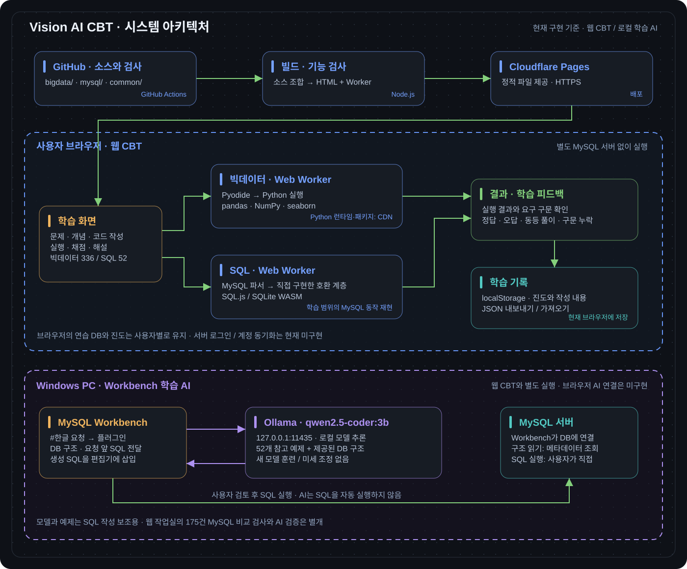
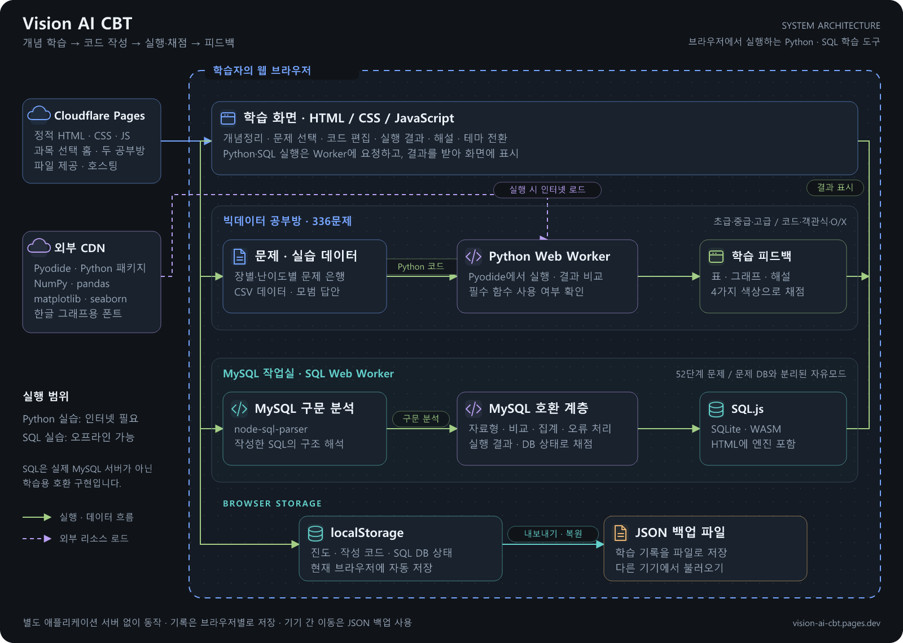

# Vision AI CBT

**개념을 확인하고, 직접 코드를 작성하고, 한 문제씩 피드백을 받는 학습 공간.**

Python 데이터 분석과 SQL을 연습하는 브라우저 기반 학습 도구입니다. 문제를 한 번에 많이 푸는 방식보다, **한 문제 작성 → 실행·채점 → 해설 확인 → 다음 문제**의 반복에 초점을 맞췄습니다.

**[사이트에서 시작하기 ↗](https://vision-ai-cbt.pages.dev/)** · [빅데이터 공부방](https://vision-ai-cbt.pages.dev/bigdata/) · [SQL 작업실](https://vision-ai-cbt.pages.dev/sql/)

## 아키텍처



웹 CBT는 브라우저에서 SQL·Python을 실행하고 학습 기록을 로컬에 저장합니다. 아래의 Workbench 학습 AI는 별도 Windows 도구이며, 웹 CBT와의 AI 연결은 아직 구현하지 않았습니다. [원본 크게 보기](common/docs/assets/architecture.svg)

### 과목별 코드 찾기

| 카테고리 | 소스와 사용 안내 | 문제·개념 | 기능 검사 |
| --- | --- | --- | --- |
| 빅데이터 | [bigdata/](bigdata/) | [코드 문제](bigdata/src/code-questions.js) · [객관식·O/X](bigdata/src/choice-questions.js) | [bigdata/tests/](bigdata/tests/) |
| MySQL | [mysql/](mysql/) | [SQL 문제·개념](mysql/src/content.js) | [mysql/tests/](mysql/tests/) |
| MySQL 학습 AI | [mysql/학습 AI/](mysql/학습%20AI/README.md) | 한글 요청 → SQL, Workbench·Ollama 로컬 실행 | [Python 테스트](mysql/학습%20AI/test_local_ai.py) |

| 빅데이터 공부방 | MySQL SQL 작업실 |
| --- | --- |
| 5–8장, 총 **336문제** | 데이터베이스 02–07 범위, 총 **52단계** |
| 초급·중급·고급 / 코드·객관식·O/X | SQL을 직접 작성하는 단계형 실습 |
| 장별 학습과 5–8장 종합 문제 | DB 생성부터 테이블·데이터·조회·수정·집계·삭제까지 |
| pandas·NumPy·seaborn 실습 | 문제와 분리된 자유 SQL 모드 |
| Pyodide를 통한 브라우저 내 Python 실행 | 내장 SQL 엔진을 통한 오프라인 실행 |

## 만든 이유

학습 초기에는 문법을 아는 것과 직접 코드를 작성하는 것 사이에 간격이 있습니다. 실행 환경을 준비하다가 학습 흐름이 끊기거나, 답안 코드가 다르다는 이유만으로 올바른 풀이를 놓칠 수도 있습니다.

이 프로젝트는 브라우저에서 곧바로 문제를 풀고, 실행 결과와 사용한 함수를 함께 확인하도록 만들었습니다. SQL 문제에서는 앞 단계에서 만든 DB를 다음 단계로 이어 사용해, 개별 문법이 실제 작업 순서에서 어떻게 연결되는지 연습할 수 있습니다.

## 학습 경험

- **개념과 실습의 연결:** 개념정리 탭에서 내용을 확인한 뒤 문제로 이동합니다.
- **결과를 고려한 채점:** 정답은 초록색, 오답은 빨간색, 코드가 달라도 결과가 같은 풀이는 파란색, 요구한 함수·구문이 빠진 풀이는 노란색으로 구분합니다. 색상과 함께 설명도 표시합니다.
- **실험할 수 있는 SQL 환경:** 자유모드의 DB는 문제 진도와 분리됩니다. 문제에서 실행만 한 내용은 미리보기로 표시하고, 통과한 DB만 다음 단계로 이어갑니다.
- **학습 기록 이동:** 브라우저에 진도와 작성 내용을 저장하고, 내보내기·백업으로 다른 기기에 옮길 수 있습니다.
- **화면 설정:** 어두운 테마와 밝은 테마를 전환할 수 있습니다.

## 시스템 아키텍처

별도 애플리케이션 서버 없이 HTML·CSS·JavaScript로 동작하는 정적 사이트입니다. Cloudflare Pages에서 제공하며, SQL과 Python 실행은 브라우저에서 처리합니다.



[그림 크게 보기](common/docs/images/architecture.png) · [수정 가능한 SVG](common/docs/images/architecture.svg) · [실행 흐름과 코드 위치](common/docs/ARCHITECTURE.md)

위 그림은 웹 공부방의 구조입니다. 별도 PC 환경에서 동작하는 Workbench 학습 AI는 [전용 아키텍처 그림](mysql/학습%20AI/docs/ARCHITECTURE.md)에서 확인할 수 있습니다.

SQL은 **실제 MySQL 서버가 아닙니다.** `node-sql-parser`의 MySQL 파서와 직접 구현한 호환 계층으로 학습 범위의 동작을 재현합니다. 자료형 변환, 문자열 비교, `NULL`, 집계·`GROUP BY`, `AUTO_INCREMENT`, 오류 처리 등을 보완했습니다. 실제 MySQL 8.0.46과 비교한 **175건이 모두 통과한 검증 보고서**를 포함하지만, 이것이 MySQL 전체 기능의 호환을 뜻하지는 않습니다. [검증 범위와 한계](common/docs/VALIDATION.md)를 함께 확인하세요.

| 구분 | 기술 |
| --- | --- |
| 화면과 상태 관리 | HTML, CSS, Vanilla JavaScript, localStorage |
| Python 실행 | Pyodide, Web Worker |
| SQL 실행 | SQL.js 1.14.1, SQLite WebAssembly |
| MySQL 구문과 호환 | node-sql-parser 5.3.13, JavaScript 호환 계층 |
| 검사와 빌드 | Node.js 22+, jsdom, GitHub Actions |
| 배포 | Cloudflare Pages, 정적 HTML |

## 실행하기

사이트 사용에는 설치가 필요 없습니다. SQL 작업실은 내장 엔진으로 오프라인에서도 실행할 수 있습니다. 빅데이터의 문제·개념 열람과 객관식·O/X는 오프라인에서도 가능하지만, **Python 코드 실행은 Pyodide와 패키지를 불러올 인터넷 연결이 필요합니다.**

개발 환경에서는 Node.js 22 이상을 사용합니다.

```bash
git clone https://github.com/chan-1215/vision-ai-cbt.git
cd vision-ai-cbt
npm ci
npm run build
npm test
npm run serve
```

`http://127.0.0.1:4173`에서 두 공부방을 확인할 수 있습니다. `common/public/`에는 빌드 결과가 이미 들어 있어, 배포된 파일을 사용하는 데 빌드는 필수가 아닙니다.

## 저장소 구성

```text
bigdata/                  빅데이터 공부방
  src/                    화면·문제·데이터·Python 실행 코드
  tests/                  빅데이터 기능 검사
  standalone/             최초 단일 HTML 원본
mysql/                    MySQL SQL 작업실
  학습 AI/                Workbench용 로컬 한글 SQL 도우미·설치·테스트·문서
  src/                    화면·문제·SQL 엔진·호환 계층
  tests/                  SQL 기능 검사와 MySQL 비교 스크립트
  standalone/             최초 단일 HTML 원본
common/                   두 과목이 함께 쓰는 운영 파일
  public/                 배포 파일: 홈, /bigdata/, /sql/
  scripts/                빌드·검사·로컬 실행
  tests/                  공통 사이트 경로·링크 검사
  docs/                   배포·개발·검증 안내
  licenses/               외부 라이브러리 라이선스
.github/workflows/        빌드와 기능 검사 자동화
```

각 과목의 `standalone/`은 원본 보관용이며 사이트용 공통 이동 메뉴가 없습니다. 수정할 때는 해당 과목의 `src/`를 수정하고 빌드하여 `common/public/`에 반영합니다. 새 과목도 같은 방식으로 최상위 폴더를 추가할 수 있습니다. [개발·배포 안내](common/docs/DEVELOPMENT.md)

일반적인 수정은 `bigdata/`, `mysql/`에서 진행합니다. 배포와 개발 도구는 [common/](common/)에 모았습니다. 루트의 `package.json`·잠금 파일은 설치·실행을 위한 설정이며, `.github/`는 자동 검사가 인식하는 고정 위치입니다.

## 확인한 내용과 제약

- SQL 52단계를 정답으로 순서대로 실행하고, 자유 DB 분리·백업 복원·진도 유지·테마 전환을 검사합니다.
- 빅데이터 336문제의 장·난이도·유형별 구성, 종합 문제 순회, 채점 표시와 저장 상태를 검사합니다.
- SQL의 WASM Worker는 실제 실행하고 네트워크 요청이 없는지 검사합니다. 빅데이터의 일부 UI 채점 검사는 Worker 응답을 모의합니다. 현재 자동 검사는 Pyodide의 전체 패키지 다운로드와 모든 Python 풀이의 브라우저 실행까지 보증하지 않습니다.
- 기록은 현재 브라우저의 로컬 저장소에 보관됩니다. 로그인·서버 동기화는 없으며, 주소나 브라우저가 달라지면 백업을 가져와야 합니다.
- 교수자 자료의 PDF 원문과 개인 학습 기록·서버 데이터는 저장소에 포함하지 않았습니다. 문제와 개념은 학습용이며 실제 시험 출제를 보장하지 않습니다.

## 라이선스 안내

사용한 외부 라이브러리는 각 라이선스를 따릅니다. [THIRD_PARTY_NOTICES.md](common/THIRD_PARTY_NOTICES.md)를 확인하세요. 프로젝트 자체에는 별도의 오픈소스 라이선스를 부여하지 않았으며, 저장소 공개만으로 자유로운 재배포 권한이 부여되는 것은 아닙니다.
