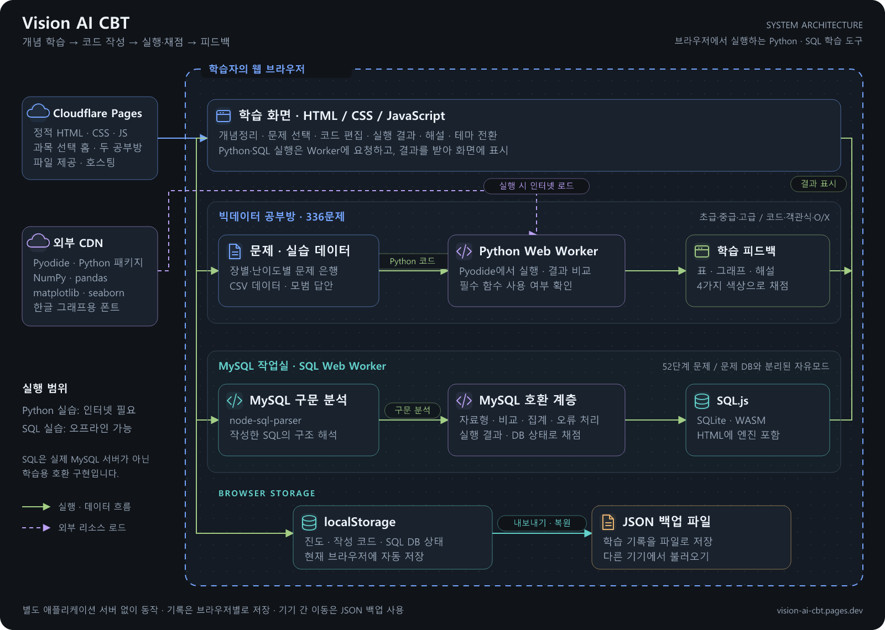

# Vision AI CBT 아키텍처

[벡터 원본 SVG](images/architecture.svg) · [프로젝트 소개](../../README.md)

그림은 운영 중인 학습 도구의 실행 구조를 나타냅니다. 초록색 화살표는 실행·데이터 흐름, 보라색 점선은 외부 리소스 로드, 파란색 점선 경계는 학습자의 브라우저를 의미합니다. 색상은 구성 요소를 구분하기 위한 것이며 직접 개발한 부분과 외부 라이브러리를 구분하는 표시는 아닙니다.

이 그림의 범위는 브라우저 웹사이트입니다. Workbench와 Ollama를 사용하는 별도 도구는 [MySQL 학습 AI 아키텍처](../../mysql/학습%20AI/docs/ARCHITECTURE.md)를 확인하세요.

## 정적 파일 제공과 실행

Cloudflare Pages는 과목 선택 홈과 두 공부방의 HTML을 제공합니다. 사용자 코드 실행을 요청받는 별도의 애플리케이션 서버는 없습니다. 화면은 JavaScript로 문제·초안·진도를 관리하고, 코드 실행은 Web Worker에 요청하여 결과를 받아 표시합니다.

## 빅데이터 공부방

장별·난이도별 문제와 실습 CSV를 HTML 안에 포함합니다. 코드 문제 실행 시 Worker에서 CDN의 Pyodide와 Python 패키지를 로드하고, CSV를 Python 가상 파일 시스템에 준비합니다. Python 보조 코드가 작성한 코드와 모범 답안의 결과를 비교하고 필수 함수 사용 여부를 확인합니다. 화면에는 표·그래프·채점·해설을 표시합니다. 객관식과 O/X 채점은 화면의 JavaScript에서 처리합니다.

그림의 Python Worker 경로는 코드 작성 문제에 해당하며, 모든 문제가 Python을 실행하는 것은 아닙니다. Python 코드 실행에는 외부 런타임과 패키지를 불러올 인터넷 연결이 필요합니다.

## MySQL SQL 작업실

SQL Worker에는 MySQL 파서, 호환 계층, SQL.js와 SQLite WASM을 포함합니다. 작성한 SQL을 구문 분석하고 학습용 MySQL 동작을 보완하여 실행합니다. 엔진과 채점 로직은 실행 결과 및 DB 상태를 확인하고, 통과한 DB만 다음 문제로 이어갑니다. 자유모드 DB는 문제 DB와 별도로 관리합니다.

그림은 주요 실행 흐름을 단순화한 것으로, 호환 처리와 엔진·채점 코드 사이에는 상호 호출이 있습니다. 실제 MySQL 서버 연결을 나타내는 것은 아닙니다. SQL 실습은 네트워크 없이 실행할 수 있으며, 전체 MySQL 기능의 호환을 보장하지 않습니다. [검증 범위](VALIDATION.md)

## 저장과 이동

진도·작성 코드·SQL DB 상태는 현재 브라우저의 localStorage에 저장합니다. JSON 내보내기·복원으로 다른 기기에 옮길 수 있습니다. 같은 계정으로 로그인하여 서버에서 기록을 동기화하는 구조는 아닙니다.

## 코드 위치

| 구성 요소 | 코드 |
| --- | --- |
| 과목 선택 홈 | [common/public/index.html](../public/index.html) |
| 빅데이터 화면·Worker 생성 | [bigdata/src/app.js](../../bigdata/src/app.js) |
| CSV·Python 실행·채점 보조 코드 | [bigdata/src/data.js](../../bigdata/src/data.js) |
| SQL 화면·저장·백업 | [mysql/src/app.js](../../mysql/src/app.js) |
| SQL Worker 메시지 처리 | [mysql/src/worker.js](../../mysql/src/worker.js) |
| SQL 기본 실행·채점 | [mysql/src/engine.js](../../mysql/src/engine.js) |
| MySQL 호환 처리 | [mysql/src/mysql-compat.js](../../mysql/src/mysql-compat.js) |
| 라이브러리·WASM을 포함하는 빌드 | [common/scripts/build.cjs](../scripts/build.cjs) |

라이브러리 라이선스는 [외부 소프트웨어 안내](../THIRD_PARTY_NOTICES.md)를 확인하세요. 이 문서와 이미지는 설명용 자료이며 사이트 실행이나 배포 설정을 변경하지 않습니다.
