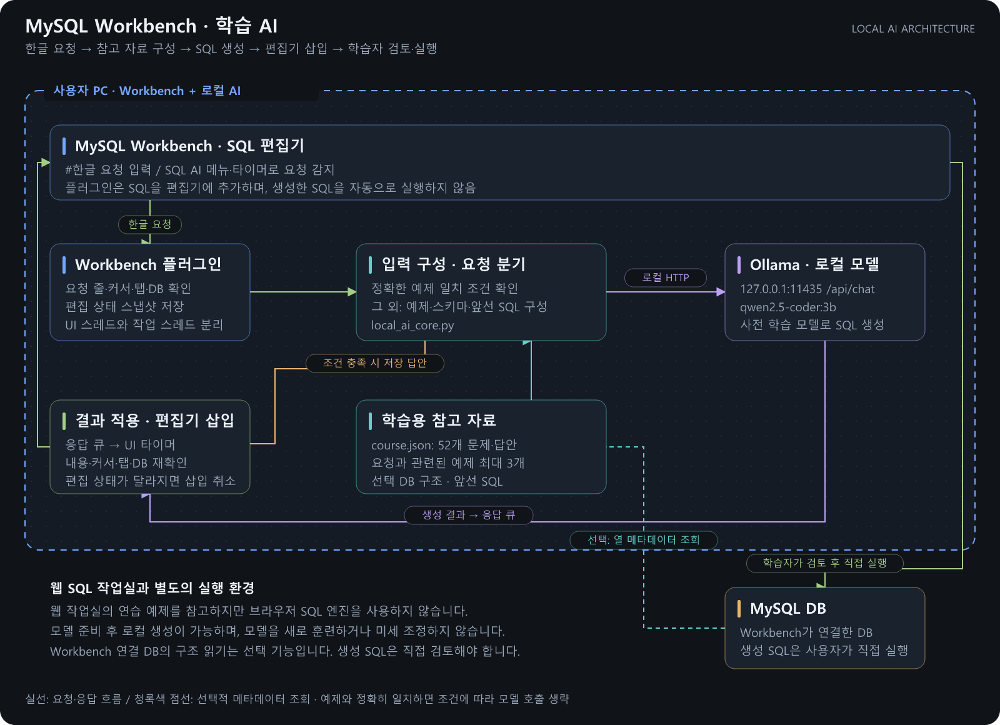
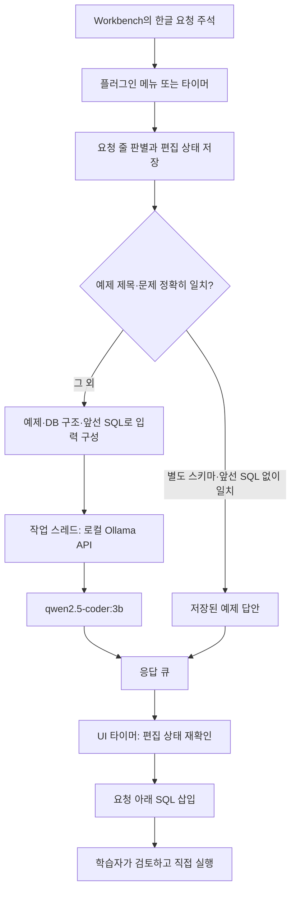

# 구성과 동작

[학습 AI 홈](../README.md)

[PNG 크게 보기](images/architecture.png) · [수정 가능한 SVG](images/architecture.svg)

파란 점선은 사용자 PC의 Workbench·로컬 AI 영역입니다. 아래 MySQL DB는 Workbench의 연결 대상으로, 반드시 같은 PC에 설치된 DB라는 뜻은 아닙니다. 생성 SQL은 편집기에만 삽입되며 학습자가 검토 후 직접 실행합니다. 청록색 점선은 선택 메뉴로 읽는 열 메타데이터 흐름입니다.

## Workbench 연동

`mysql_korean_ai_grt.py`는 GRT 모듈 `KoreanLocalSQLAI`를 등록합니다. 시작 시 `initialize()`에서 `Menu/SQL AI` 그룹을 만들고 세 명령을 연결합니다. 메뉴 그룹은 `SQLEditor` 범주입니다.

| 명령 | 역할 |
| --- | --- |
| `local.sqlai.generate` | 현재 요청을 한 번 생성 |
| `local.sqlai.auto` | 감시할 SQL 탭 설정 또는 해제 |
| `local.sqlai.schema` | 선택 DB의 열 메타데이터 조회 |

Workbench UI 접근은 UI 스레드에서 처리합니다. `mforms.Utilities.add_timeout`은 0.35초마다 상태를 확인하고, 요청 줄 다음 빈 줄에서 상태가 약 0.8초 안정되면 생성합니다. 이는 키보드 Enter 이벤트를 직접 가로채는 구현이 아니라 편집기 텍스트와 커서를 주기적으로 관찰하는 방식입니다. 따라서 같은 상태를 만드는 붙여넣기 등도 트리거가 될 수 있습니다.

네트워크 생성은 작업 스레드에서 실행하고 결과 큐로 전달합니다. 응답 적용 전에 내용·커서·탭·기본 DB가 요청 당시와 같은지 확인합니다. 다르면 텍스트를 삽입하지 않습니다. DB 변경을 감지하는 것은 최종 상태 비교이며 생성 중간의 모든 변경 이력을 추적하지는 않습니다.

Workbench 커서 위치는 UTF-8 바이트 단위로 다루고 Python 문자열 위치와 변환합니다. 기존 SQL을 교체하는 대신 요청 아래에 추가합니다. 진행 출력이 실패하면 GRT 로그와 상태 표시줄을 사용합니다.

## 모델 입력

`local_ai_core.py`는 Python 표준 라이브러리만 사용합니다. 프록시를 무시하는 HTTP 클라이언트로 `http://127.0.0.1:11435/api/chat`에 요청합니다.

- 요청: 1~3,000자, 한글 요청 트리거 사용
- 요청 앞 SQL: 마지막 최대 10,000자
- 읽은 스키마: 최대 16,000자
- 참고 예제: 토큰 포함 여부 점수로 상위 3개 선택
- 생성 옵션: temperature 0, num_ctx 8192, num_predict 1000, keep_alive 15m
- SQL 응답: 코드 펜스 정리 및 시작 구문·길이 검사

문자 수 제한과 모델 토큰 한도는 서로 다릅니다. 긴 입력은 모델 문맥 한도를 넘을 수 있습니다. 예제 검색은 단순 문자열 점수이며 임베딩 검색이나 벡터 DB를 사용하지 않습니다.

시스템 프롬프트로 없는 열을 만들지 않도록 지시하지만 강제 검증은 아닙니다. 응답 검사는 SQL 파싱·권한 검사·실행 계획 검증을 하지 않습니다. 요청에 따라 INSERT·UPDATE·DELETE·DDL도 반환할 수 있습니다. 플러그인이 실행하는 DB 쿼리는 구조 읽기 메뉴의 `information_schema.COLUMNS` 조회이며, 생성 SQL의 실행 코드는 없습니다.

## 웹 SQL 작업실과의 관계

`course.json`은 저장소 SQL 작업실의 52단계 문제·답안과 연습 테이블을 스냅샷으로 담습니다. 실습 데이터는 합성 예제이며 학습자 DB 덤프를 사용하지 않습니다. 자동 동기화 기능은 없으므로 원본 문제를 바꾸면 함께 확인해야 합니다.

웹 작업실은 브라우저의 SQL 호환 엔진에서 동작합니다. 이 폴더는 실제 Workbench·MySQL 연결을 사용하므로 별도의 실행 환경이 필요합니다.
